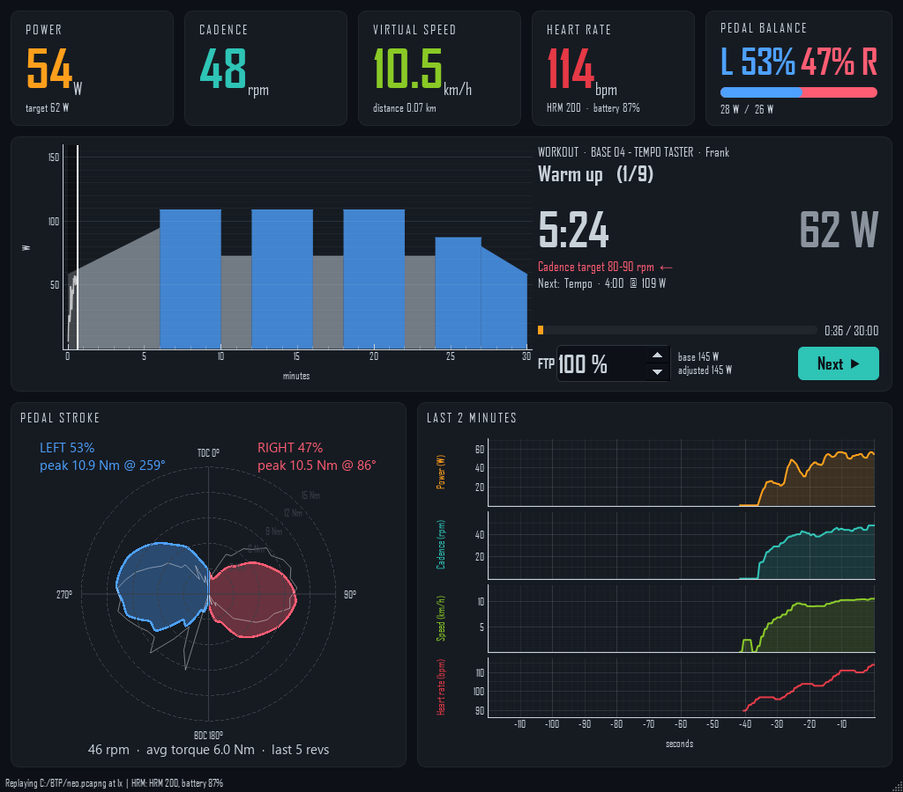

# Tacx_claude
A simple python workout program for controlling a Tacx Neo 2T and a HRM200 heart rate monitor. (I haven't tried any other hardware)

Untouched by Human Hands



## Setup

Needs Windows 10 or 11 with Bluetooth. The trainer and heart rate strap don't need to be paired in Windows.

1. Install Python 3.12 or newer, from [python.org](https://www.python.org/downloads/) (keep the "py launcher" option ticked) or with:
   ```
   winget install Python.Python.3.13
   ```
2. Clone this repository and open a terminal in its folder.
3. Create a virtual environment called `.venv` in the project folder (`launcher.bat` looks for it there):
   ```
   py -m venv .venv
   ```
4. Install the libraries (about 500 MB, mostly PySide6):
   ```
   .venv\Scripts\python -m pip install -r requirements.txt
   ```

After a `git pull`, repeat step 4 if `requirements.txt` has changed.

ANT+ is optional: it needs a USB ANT+ stick with the WinUSB driver (install it with [Zadig](https://zadig.akeo.ie/)). Everything else works over Bluetooth alone.

## Run

```
launcher.bat
```

Pick a rider (or create one with **New rider**) and a workout, then press **Ride ▶**. Close any other app connected to the trainer first, such as the Tacx app or Zwift.

